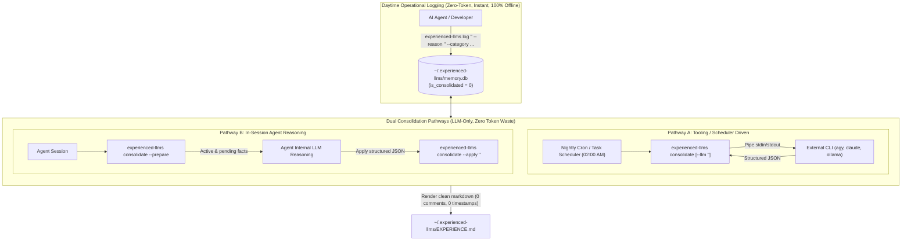

<p align="center">
  
</p>

# Experienced LLMs (v1.0.0rc3)

> **Universal Self-Learning Heuristic Ledger & Autonomous Consolidation Engine for AI Coding Agents**

[](https://opensource.org/licenses/MIT)
[](https://github.com/developer88/experienced-llms/releases)
[](https://agenticskills.io/methodology)

This is not a traditional vector AI memory. The goal is to add **self-education to LLM agents**. We equip AI models with tools and abilities via Skills and MCP, and customize their behaviour via `AGENTS.md` or system prompts, but tailoring them continuously is hard and time-consuming.

**Experienced LLMs** gives AI agents a tool to learn from your daily feedback, mistakes, and architectural choices. It does not replace `AGENTS.md`, Skills, or MCPs—instead, it significantly improves your local agents by synthesizing your operational wisdom into a lean, authoritative master experience document.

---

## 🔒 Privacy-First: Two Files Only (Zero Workspace Clutter)

Experienced LLMs provides an unconditional privacy guarantee:
- **Zero repository scanning**: It never indexes, inspects, or uploads your workspace source code, private files, or git history.
- **Zero workspace pollution**: No `.experienced/` or scratch directories created inside your projects.
- **Zero intermediate clutter**: Eliminates raw daily logs, markdown transcripts, and unpruned temporary files.
- **100% Contained to Two Files**: Everything lives strictly inside your user home directory `~/.experienced-llms/`:
  1. `~/.experienced-llms/memory.db`: Local SQLite database (WAL mode) storing structured heuristic ledgers, sessions, migrations, and consolidation audits.
  2. `~/.experienced-llms/EXPERIENCE.md`: Single, authoritative, consolidated operational rulebook injected into agents on startup.

---

## 🏗️ Architecture: Dual Consolidation Engine



### 1. Daytime Operational Capture (Zero Tokens, 100% Offline)
When you correct an agent or establish a project rule, no LLM call is made. The rule is written deterministically to `~/.experienced-llms/memory.db` with `is_consolidated = 0`. Fast, free, and completely offline.

### 2. Autonomous Consolidation (LLM-Only, Zero Fallbacks)
Nightly or on demand, consolidation merges pending facts into the active rulebook:
- **Semantic Deduplication**: Paraphrased or overlapping entries are merged into single, concise directives.
- **Contradiction Resolution**: If a newer rule invalidates an older directive, the older rule is superseded in SQLite.
- **Zero Token Waste**: Stripped of HTML comments (`<!-- ... -->`) and generation timestamps.
- **5 Canonical Sections**:
  1. `## 1. User Directives & Preferences`
  2. `## 2. Defensive Safeguards & Heuristics`
  3. `## 3. Project-Specific Constraints`
  4. `## 4. Anti-Patterns & Critical Gotchas`
  5. `## 5. Mistake Corrections & Fixes`

---

## ⚡ One-Click Installation

### Linux / macOS / WSL
```bash
git clone https://github.com/developer88/experienced-llms.git
cd experienced-llms
bash install.sh
```

### Windows (PowerShell)
```powershell
git clone https://github.com/developer88/experienced-llms.git
cd experienced-llms
.\install.ps1
```

The installer automatically initializes your local database baseline (`001_1_0_0rc3_baseline`), adds binary wrappers to your PATH (`~/.local/bin/experienced-llms` or `experienced-llms.cmd`), configures agent skills, and registers a nightly consolidation schedule (02:00 AM).

---

## 🚀 Quickstarts

### 👤 Developer Quickstart (Human)

1. **Log a rule or preference**:
```bash
experienced-llms log "Always run npm inside WSL, never directly on Windows" \
  --category user_preference \
  --reason "Avoid Windows path resolution issues"
```

2. **Inspect your active rulebook**:
```bash
experienced-llms show
```

3. **Manually trigger consolidation**:
```bash
# Using external CLI command (e.g. agy, claude, ollama)
experienced-llms consolidate --llm "agy query"

# Or using configured API provider (gemini, claude, openai, ollama)
experienced-llms consolidate --provider gemini
```

4. **Re-render EXPERIENCE.md directly from SQLite facts**:
```bash
experienced-llms render
```

---

### 🤖 Agent Quickstart (LLM / Agentic Skills)

If you are an AI coding agent (Antigravity, Cursor, Copilot, Claude Code):

1. **On Session Start**:
   Read `~/.experienced-llms/EXPERIENCE.md`. Strictly adhere to all directives, project constraints, and defensive heuristics defined there.

2. **During Session (Daytime Capture)**:
   Proactively log operational heuristics (Reason $\rightarrow$ Outcome), bug corrections, or user preferences:
   ```bash
   experienced-llms log "<operational rule>" --reason "<why/root cause>" --category [defensive_heuristic|user_preference|technical_decision|mistake_correction|project_gotcha]
   ```

3. **Nightly Consolidation (Pathway B)**:
   - Run `experienced-llms consolidate --prepare` to obtain structured prompt and facts.
   - Synthesize and resolve contradictions with your reasoning engine.
   - Run `experienced-llms consolidate --apply '<json_payload>'` to commit the updates.

---

## 🛠️ CLI Command Reference

| Command | Description |
|---|---|
| `experienced-llms log "<rule>" ...` | Log an intraday heuristic (zero tokens, instant, offline) |
| `experienced-llms consolidate` | Consolidate pending facts into `EXPERIENCE.md` via LLM |
| `experienced-llms consolidate --prepare` | Output prompt payload for in-session agent reasoning (Pathway B) |
| `experienced-llms consolidate --apply '<json>'` | Apply structured consolidation output to SQLite and markdown |
| `experienced-llms render` | Rebuild clean `EXPERIENCE.md` directly from active SQLite facts |
| `experienced-llms show` | Print active `~/.experienced-llms/EXPERIENCE.md` |
| `experienced-llms migrate` | Run pending full-stack migrations (DB, skills, scripts, config) |
| `experienced-llms schedule --install` | Install nightly consolidation daemon (02:00 AM) |
| `experienced-llms schedule --uninstall` | Remove nightly consolidation daemon |
| `experienced-llms schedule --status` | Check status of scheduled consolidation daemon |
| `experienced-llms integrate --target all` | Configure instructions across Antigravity, Claude, Copilot, Cursor, Pi |
| `experienced-llms --version` | Display version information (`1.0.0rc3`) |

---

## 🧩 AgenticSkills Standards Compliance

Experienced LLMs is packaged in full accordance with the [agenticskills.io/methodology](https://agenticskills.io/methodology) standard:
- **Canonical Skill Location**: `skills/experienced-llm/SKILL.md`
- **Spec-Compliant Frontmatter**: Name, description (< 200 chars), version (`1.0.0rc3`), author, repository, license, and keywords.
- **Safety & Containment**: 100% offline daytime operation, zero capability escalation, zero private data leakage.

---

## 📜 Full-Stack Migration Scaffolding (Omakub / Rails Style)

Prepared for seamless updates across 4 distinct operational layers:
1. **SQLite Database Schema**: Sequential scripts (`migrations/00X_*.sql` or `.py`).
2. **Agent Skill Definitions**: Synchronizing updated `SKILL.md` to agent directories.
3. **CLI Scripts & Tooling**: Updating binary shims and system schedulers.
4. **Configuration**: Injecting new configuration keys without overwriting user settings.

Fresh installs in `1.0.0rc3` record `001_1_0_0rc3_baseline` in `schema_migrations` and exit cleanly.

---

## 📄 License

MIT © [developer88](https://github.com/developer88)
