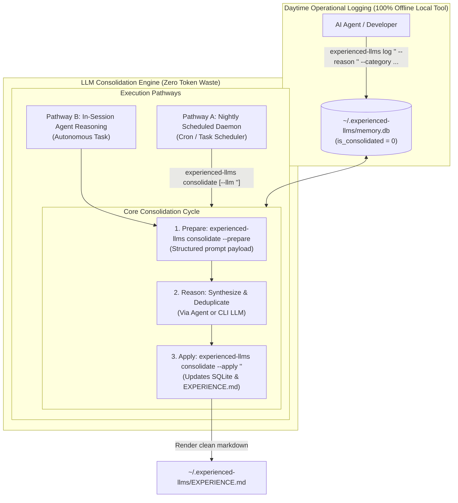

<p align="center">
  
</p>

# Experienced LLMs

[](https://opensource.org/licenses/MIT)
[](https://github.com/developer88/experienced-llms/releases)
[](https://agenticskills.io/methodology)

This is not an AI memory, the goal is to add self-education to LLM agents. We give AI tools and abilities via Skills and MCP, we modify some of their behaviour via `AGENTS.md`, but tailoring it further is hard and time consuming.

Let's give AI a tool to learn on our feedback from day to day. It will not replace `AGENTS.md`, nor Skills or MCPs, but it will significantly improve your local agents and make them more tailored to you.

This is a compiled production ready result of my 6 month experiment, that just works.

---

## 🔒 Privacy-First: Two Files Only

Experienced LLMs is built with a strict privacy guarantee:
- **Zero repository scanning**: It never indexes, inspects, or uploads your workspace source code, private files, or git commit history.
- **Zero workspace pollution**: It never injects hidden dotfiles or configuration directories into your code repositories.
- **100% Contained to Two Files**: Everything lives strictly inside your user home directory `~/.experienced-llms/`:
  1. `~/.experienced-llms/memory.db`: Local SQLite database (WAL mode) storing structured heuristic ledgers, sessions, migrations, and consolidation audits.
  2. `~/.experienced-llms/EXPERIENCE.md`: Single, authoritative, consolidated operational rulebook injected into agents on startup.

---

## 🏗️ Architecture: Dual Consolidation Engine



### 1. Daytime Operational Capture (100% Offline, Local CLI Tool)
When an agent or developer records a correction or project preference, the rule is stored directly in `~/.experienced-llms/memory.db` with `is_consolidated = 0`. The CLI tool runs instantly and offline without invoking external LLM APIs.

### 2. Autonomous Consolidation (LLM-Only)
Nightly or on demand, consolidation merges pending facts into the active rulebook:
- Deduplicates and generalizes heuristics across the 5 canonical sections.
- Resolves contradictions by marking outdated rules as superseded in SQLite.
- Strips HTML comments and timestamps to guarantee zero token waste.

---

## ⚡ Quick Start: 1-Line Terminal Installation

No compiler, Python, or multi-step dependency setup required. Copy and paste a single command into your terminal:

### POSIX (Linux, macOS, Ubuntu, Arch, Debian, WSL)
```bash
curl -fsSL https://github.com/developer88/experienced-llms/releases/latest/download/install.sh | bash
```

### Windows 11 (PowerShell)
```powershell
irm https://github.com/developer88/experienced-llms/releases/latest/download/install.ps1 | iex
```

The installer automatically:
1. Detects your operating system and architecture (`x86_64`, `aarch64`, macOS Apple Silicon / Intel, Windows).
2. Installs the high-performance standalone native Rust binary to `~/.local/bin/` (or Windows user programs directory).
3. Configures your user profile `PATH` (`.bashrc`, `.zshrc`, or Windows Environment).
4. Initializes local SQLite storage at `~/.experienced-llms/memory.db`.
5. Connects agent skills for Antigravity, Claude, Copilot, Cursor, and Pi.
6. Configures the automated nightly consolidation daemon (cron or Windows Task Scheduler).

---

### Alternative / Offline / Source Installation

If you prefer building from source or working offline:

```bash
# Clone the repository
git clone https://github.com/developer88/experienced-llms.git
cd experienced-llms

# Build and install standalone binary via Cargo
cargo install --path .

# Or run the local installer script (auto-detects local repository & builds if needed)
bash install.sh        # On Linux / macOS / WSL
.\install.ps1          # On Windows PowerShell
```

---

## 🚀 Usage Reference

### 1. Log an Operational Rule or Preference
```bash
experienced-llms log "Always run npm inside WSL, never directly on Windows" \
  --category user_preference \
  --reason "Avoid Windows path resolution issues"
```

### 2. Inspect Active Rulebook
```bash
experienced-llms show
```

### 3. Run Consolidation
```bash
# Using external CLI tool (e.g. agy, claude, ollama)
experienced-llms consolidate --llm "agy query"

# Or using configured API provider (gemini, claude, openai, ollama)
experienced-llms consolidate --provider gemini
```

### 4. Re-render EXPERIENCE.md from SQLite Facts
```bash
experienced-llms render
```

---

## 🧠 Consolidation Algorithm & Customization

The cognitive consolidation engine distills daytime learnings into high-density operational guidance while preserving factual integrity via an immutable SQLite ledger.

### Core Consolidation Rules
1. **Semantic Deduplication**: Merges overlapping heuristics into sharp, concise directives.
2. **Contradiction Resolution**: Detects obsolete rules and marks them `superseded` in SQLite.
3. **5 Canonical Categories**: Preserves standard operational sections (User Directives, Defensive Safeguards, Project Constraints, Anti-Patterns, Mistake Corrections).
4. **Token Density & Word Ceiling**: Restricts output length (`--max-words`, default 1200 words) with zero HTML comments or timestamps.

### Custom Prompt Templates
You can customize consolidation instructions and section taxonomy:
- **Global override**: Place your template at `~/.experienced-llms/consolidation_prompt.txt`.
- **One-off override**: Use `experienced-llms consolidate --template /path/to/template.txt`.

For detailed architecture, JSON schemas, and domain-specific examples, see [Consolidation Algorithm Guide](docs/consolidation_algorithm.md).

---

## 🛠️ CLI Command Reference

| Command | Arguments / Flags | Description |
|---|---|---|
| `experienced-llms log "<rule>"` | `--category`, `--scope`, `--reason`, `--session-id` | Log an intraday heuristic (fast, offline, local) |
| `experienced-llms consolidate` | `--date`, `--provider`, `--llm`, `--max-words`, `--template` | Consolidate pending facts into `EXPERIENCE.md` via LLM (Pathway A) |
| `experienced-llms consolidate --prepare` | `--date`, `--max-words`, `--template` | Output prompt payload for in-session agent reasoning (Pathway B step 1) |
| `experienced-llms consolidate --apply '<payload>'` | (Accepts JSON string or file path) | Apply structured consolidation payload to SQLite and markdown (Pathway B step 3) |
| `experienced-llms render` | *(None)* | Rebuild clean `EXPERIENCE.md` directly from active SQLite facts |
| `experienced-llms show` | *(None)* | Print active `~/.experienced-llms/EXPERIENCE.md` |
| `experienced-llms status` | *(None)* | Show active facts, auto-skills, and schedule state |
| `experienced-llms setup` | `--provider`, `--key`, `--model` | Configure LLM providers and credentials |
| `experienced-llms schedule` | `--install`, `--uninstall`, `--status`, `--time`, `--type` | Manage scheduled nightly consolidation daemon |
| `experienced-llms prompt` | `--target`, `--skill`, `--scope` | Generate ready-to-inject prompt for orchestrator or worker |
| `experienced-llms integrate` | `--target`, `--workspace` | Install instructions into AI agents (Antigravity, Claude, Copilot, Cursor, Pi) |
| `experienced-llms migrate` | *(None)* | Run pending full-stack migrations across DB, skills, and configuration |
| `experienced-llms init` | *(None)* | Initialize SQLite schema and directory structure |
| `experienced-llms --version` | `-v` | Display version information (`1.0.0rc3`) |

---

## 🧩 AgenticSkills Standards Compliance

Experienced LLMs is packaged in full accordance with the [agenticskills.io/methodology](https://agenticskills.io/methodology) standard:
- **Canonical Skill Location**: `skills/experienced-llm/SKILL.md`
- **Spec-Compliant Frontmatter**: Name, description (< 200 chars), version (`1.0.0rc3`), author, repository, license, and keywords.
- **Safety & Containment**: 100% offline daytime operation, zero capability escalation, zero private data leakage.

---

## 📄 License

MIT © [Andrey Eremin (developer88)](https://github.com/developer88)
