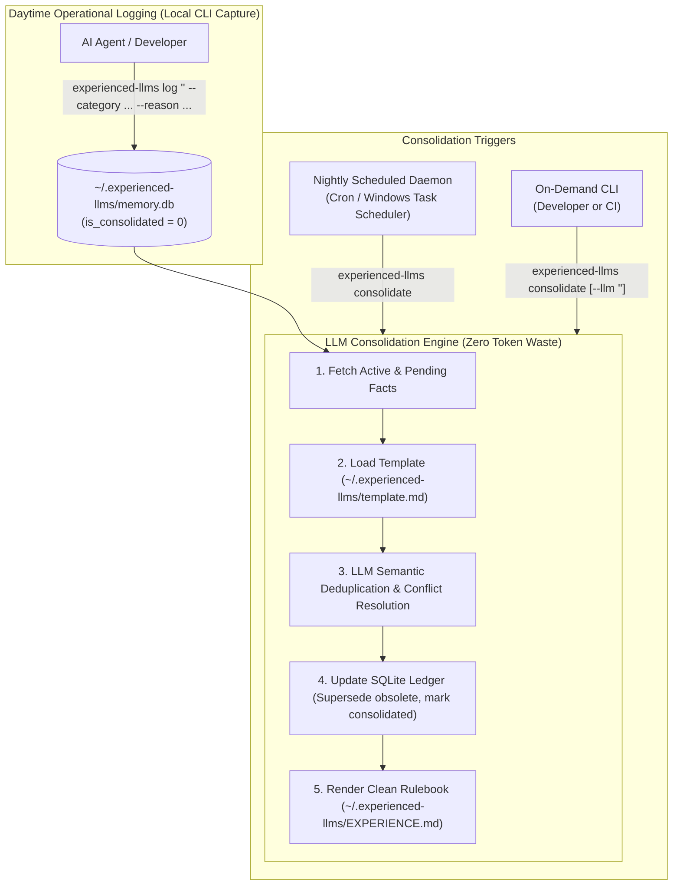

# Experienced LLMs: Architecture & System Design

`Experienced LLMs` provides an autonomous, self-educating operational guidance layer for AI coding agents. It separates daytime fact logging from periodic semantic consolidation, maintaining an immutable audit ledger while generating a token-dense, authoritative rulebook for agents.

---

## 🏗️ System Architecture



---

## 🧩 2-Component Architecture

Experienced LLMs operates across two clean, strictly separated components:

### 1. Local Engine & Storage (`~/.experienced-llms/`)
The native Rust engine and its local data store live entirely in the user's home directory:
- **`memory.db`**: Local SQLite database (WAL mode) maintaining the immutable ledger of atomic facts, category taxonomies, session IDs, and consolidation audit histories.
- **`EXPERIENCE.md`**: The compiled, token-dense master operational rulebook generated by the consolidation engine.
- **`template.md`**: The markdown template defining instructions and canonical section taxonomy used during consolidation.
- **`config.json`**: Optional configuration for default LLM CLI command, schedule, and maximum word counts.

### 2. Injected Agent Guidance (Agent Skills / Directives)
Lightweight instructions injected into AI agents (e.g. Antigravity, Claude Desktop/Code, Copilot, Cursor, Pi):
- Instructs the agent to consult `~/.experienced-llms/EXPERIENCE.md` at the start of sessions to respect existing preferences, safeguards, and corrections.
- Instructs the agent to invoke `experienced-llms log "<directive>" --reason "<why>"` when a user corrects behavior or specifies an ongoing workflow constraint.

---

## 🔄 The Life Cycle of an Operational Rule

### 1. Daytime Operational Capture
When an agent or developer records a correction or preference:
```bash
experienced-llms log "Always run npm inside WSL, never directly on Windows" \
  --category user_preference \
  --reason "Avoid Windows path resolution issues"
```
The command executes in milliseconds, appending the row to SQLite with `is_consolidated = 0`.

### 2. Autonomous Consolidation
Consolidation runs on a schedule (e.g. nightly at 02:00) or on-demand:
```bash
# Using external CLI tool
experienced-llms consolidate --llm "agy query"

# Or configure default command once:
experienced-llms setup --llm "agy query"
experienced-llms consolidate
```
The consolidation process:
1. **Reads Pending & Active Facts**: Gathers unconsolidated facts alongside current rules.
2. **Loads Consolidation Template**: Reads `~/.experienced-llms/template.md`. Fails hard if missing.
3. **Semantic Deduplication**: Merges overlapping heuristics across standard sections.
4. **Contradiction Resolution**: Detects obsolete rules and marks them `superseded` in SQLite.
5. **Ledger Update & Markdown Render**: Marks processed entries as consolidated and rebuilds `~/.experienced-llms/EXPERIENCE.md`.

### 3. Rendering & Token Density
The resulting `EXPERIENCE.md`:
- Adheres strictly to the configured maximum word ceiling (default 1200 words).
- Contains zero HTML comments, zero generation timestamps, and zero conversational padding.
- Can be re-rendered at any time directly from the active facts in SQLite via `experienced-llms render`.
